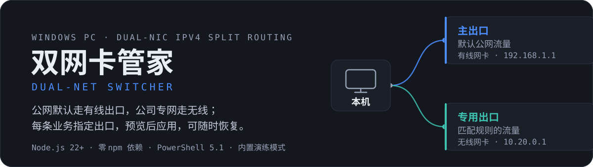
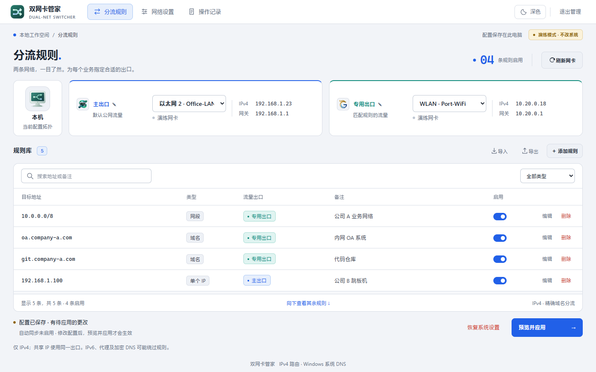
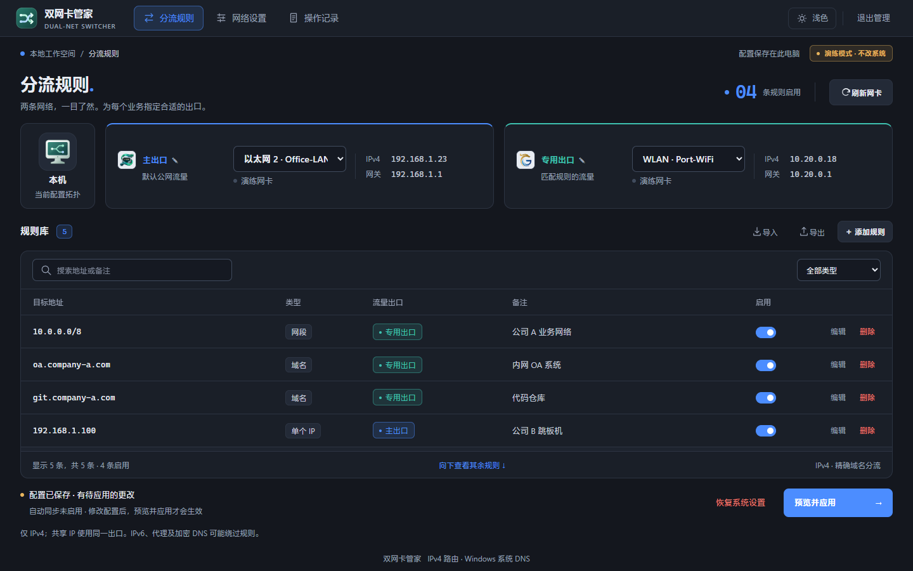

<p align="center">
  
</p>

<p align="center">
  
  &nbsp;
  
  &nbsp;
  
  &nbsp;
  
</p>

<p align="center">
  
  &nbsp;
  
</p>

## 这是什么

一台 Windows PC 同时接**有线**和**无线**两张网卡时：公网默认出口必须稳稳留在有线，指定业务（公司 OA、内网系统等）要走无线专网。双网卡管家把这件事做成可视化的规则管理——自动识别网卡、网关、接口索引和 DNS，维护域名 / 单 IP / CIDR / 尾部通配网段，**预览后应用，失败自动补偿，按资源所有权恢复**，绝不批量清空系统路由。

- 纯 Node.js + Windows PowerShell + 原生网页，无第三方运行依赖、无需构建。
- 管理界面按需打开；静态分流由 Windows 持续执行，动态域名由计划任务短暂唤醒更新，无常驻服务。
- 网卡下拉直接显示网络名：WiFi 显示 SSID，有线显示网络配置文件名，一眼区分两个出口。
- 浅色 / 深色双主题，顶栏一键切换，选择跨随机端口记忆。

## 快速开始

需要 **Node.js 22+**，Windows 自带的 PowerShell 5.1、NetTCPIP、DnsClient 与 ScheduledTasks。无需 `npm install`。

1. **先演练**：双击 `演练模式.cmd`。网卡、DNS 与系统修改全部内存模拟，真实系统零改动。
2. **接真实网卡**：双击 `以管理员身份启动.cmd`（UAC 授权；取消不改网络）。普通权限的 `启动.cmd` 可维护规则、读取网卡、预览。
3. **确认两个出口** →「网络设置」修正网关或专属 DNS（留空用网卡自动值）→ 添加规则 →「预览并应用」。

规则默认**自动识别**，粘贴即可：

| 你输入的 | 保存为 |
| --- | --- |
| `http://129.0.8.134:7001/console?...` | 单个 IP `129.0.8.134`（端口/路径忽略） |
| Markdown 链接 `[文字](https://oa.company.com/login)` | 域名 `oa.company.com` |
| `172.18.28.X` 或 `172.18.28.*` | 网段 `172.18.28.0/24` |
| `172.18.X.X` / `10.X.X.X` | `/16` / `/8`（仅允许连续尾部通配） |

两个出口各自独立 DNS（留空用网卡自动值），只作用于该出口的域名规则；出口名称可自定义（24 字符），改名即时生效、不需重新应用路由。

## 工作方式

- 网卡以 **GUID** 识别，每次执行重新核对接口索引与系统快照；接口跃点控制默认出口优先级，发现更优默认出口或 VPN 冲突时**阻止应用**，避免假成功。
- IP / CIDR 写持久路由；域名 A 记录与 DNS 查询路径用活动路由，避免把过期解析地址永久写入系统。同一目的 IP 要求相反出口时直接拒绝。
- 精确域名绑定所选网卡源 IPv4 查询 DNS，并同步 NRPT 精确策略；不写 hosts，不支持 `*.example.com` 后缀规则。
- 应用与恢复前先记录系统资源**原值与所有权**，写后回读核验，失败自动补偿；恢复只处理本工具拥有的资源，保留借用的用户路由。
- 自动同步只使用**最后成功应用**的配置；「后台自动维护」由当前用户专属计划任务短暂唤醒执行，管理窗口打开时自动跳过，避免并发写者。
- 退出管理即关闭服务进程，已应用的分流继续生效。

## 验证

```powershell
npm test              # Node 内置测试 + Windows 隔离资源模拟（29 项）
npm run check         # 源码语法检查
npm run verify:ui     # Playwright + Edge 隔离演练：完整业务流程 × 3 轮
npm run verify:theme  # 双主题切换/持久化/跨端口记忆/受限存储 + 双尺寸截图
```

模拟测试不修改宿主网络。**真实双网卡环境已完成集成验收**（2026-10-20）：管理员权限下的路由写入/恢复、NRPT、计划任务注册/注销、Wi-Fi 断开重连自愈、界面退出后的提权单次维护均实测通过；睡眠/唤醒与重启登录后的策略恢复未实测。详见 [docs/VERIFICATION.md](docs/VERIFICATION.md)。

## 范围与限制

- 仅管理 **IPv4** 与精确域名：IPv6、VPN 更具体路由、代理、浏览器 DoH 可能绕过，工具不会擅自禁用它们。
- 共享同一目的 IP 的不同域名不能使用不同出口。
- 指定的 DNS 必须先可通过所选网卡访问；不支持在一次事务内“先建 DNS 路径、再解析域名”的自举。
- 系统变更是补偿事务而非数据库事务；恢复失败时保留 journal 并明确报告，不要手工删除所有权文件绕过保护。

## 文件与数据

| 位置 | 用途 |
| --- | --- |
| `data/config.json` | 用户配置草稿，原子保存，可导入导出 |
| `data/runtime.json` | 最后成功应用的配置与域名最近成功结果 |
| `data/windows-state/` | Windows 资源原值、所有权与事务日志，请保留 |
| `docs/` | 架构取舍、设计规范、验证记录与界面截图 |

网页仅监听本机回环、端口随机，管理入口含私密会话令牌——**不要分享 `data/session.json` 或启动输出里的完整网址**。

## 文档

- [docs/ARCHITECTURE.md](docs/ARCHITECTURE.md) — 参考项目批判与架构取舍
- [docs/DESIGN.md](docs/DESIGN.md) — 双主题设计规范
- [docs/VERIFICATION.md](docs/VERIFICATION.md) — 验证结果与未实测边界
- [docs/evidence/theme/](docs/evidence/theme/) — 浅/深主题界面截图
